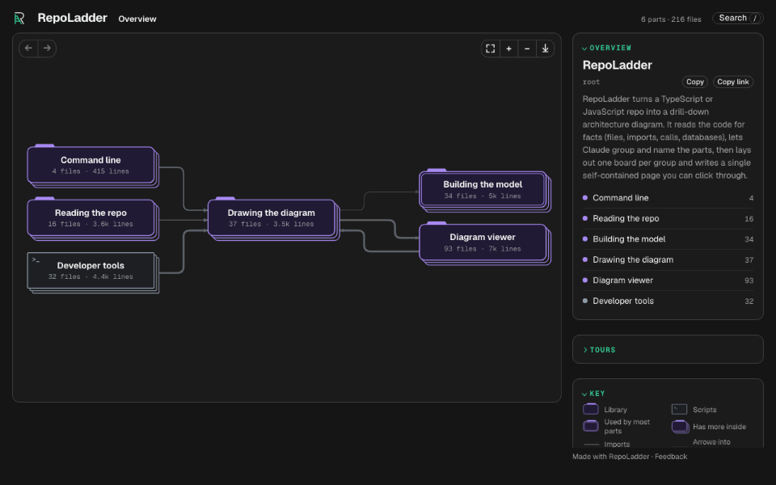

<p align="center">
  <picture>
    <source media="(prefers-color-scheme: dark)" srcset="docs/media/logo-dark.svg">
    
  </picture>
</p>

<h1 align="center">RepoLadder</h1>

<p align="center"><strong>Architecture diagrams grounded in your code that stay in sync.</strong></p>

<p align="center">
  <a href="LICENSE"></a>
  <a href="https://www.npmjs.com/package/repoladder"></a>
  <a href="https://github.com/RepoLadder/repoladder/actions/workflows/ci.yml"></a>
  <a href="https://www.npmjs.com/package/repoladder"></a>
</p>

<p align="center">
  <a href="https://repoladder.com/browse">Live demo</a> ·
  <a href="docs/install.md">Install</a> ·
  <a href="#documentation">Documentation</a> ·
  <a href="#is-it-safe-to-install">Safe to install</a>
</p>

**Run one command on your TypeScript or JavaScript repo. In a few minutes you get a diagram a newcomer can click through and understand, and every box and arrow comes from the code.**

It starts with the big pieces in plain language. Open any box to go one rung deeper and one step more technical, down to the files. Tours walk a real flow through the code, moving up, across and down the rungs as the flow does.



<sub>A tour on RepoLadder's map of its own code, in the dark theme, recorded from the real viewer.</sub>

## See it on a real repo

Live diagrams you can click through, no install needed:

| Repo | What it is | Diagram |
|---|---|---|
| [Excalidraw](https://github.com/excalidraw/excalidraw) | The open-source whiteboard app and its embeddable editor, in one monorepo. | [Open the diagram](https://repoladder.com/demo/excalidraw/) |
| [Open Agents](https://github.com/vercel-labs/open-agents) | Vercel's open-source background coding agent, with a sandbox, Postgres, Redis and GitHub. | [Open the diagram](https://repoladder.com/demo/open-agents/) |
| [Taxonomy](https://github.com/shadcn-ui/taxonomy) | shadcn's Next.js App Router example app, with Prisma, NextAuth and Stripe. | [Open the diagram](https://repoladder.com/demo/taxonomy/) |
| [Epic Stack](https://github.com/epicweb-dev/epic-stack) | Kent C. Dodds' full-stack React Router starter, with Prisma, Resend and Sentry. | [Open the diagram](https://repoladder.com/demo/epic-stack/) |

[Browse all maps](https://repoladder.com/browse)

<!-- Rows follow gallery/demos.json (order, names, urls), checked by test/readme.test.ts. Titles and blurbs are copied from the website's demo list; keep them in step. -->

## What it does and doesn't do

| | What to expect |
|---|---|
| **Languages** | TypeScript and JavaScript (`.ts .tsx .mts .cts .js .jsx .mjs .cjs`). A repo with no such files stops with a message; other languages are not read. |
| **Drawn from the code** | Boxes of files, imports, runtime calls by function name or URL, database reads and writes, SDK imports of outside services, server endpoints. Click an arrow for the file and line behind it. |
| **Only named by the AI** | Claude groups files into parts and gives them names, summaries and tours. It cannot add an arrow: arrows always come from the code facts, and a grouping that leaves a file out is rejected. |
| **Runs on your machine** | Reading the repo, laying out the diagram and writing `.repoladder/` all run locally. RepoLadder itself sends nothing unless you opt in to anonymous usage stats; as in any Claude Code session, Claude sees the repo summary through your own Claude account. Details: [PRIVACY.md](PRIVACY.md#where-things-run). |
| **Time** | Analysis and layout take under about 5 seconds up to ~300 files, and about 10 seconds at 500 files. Most of a `/map` run is Claude reading the digest and naming the parts. |
| **Tokens** | Claude reads the skill and a digest of the repo (capped): roughly 6K input tokens for a small repo and 16K for a large one, plus the grouping it writes. These count against your Claude plan like any other Claude Code turn. |
| **Without AI** | `npx repoladder build . --default` groups by folders, costs no tokens and still draws every arrow from the code. |
| **Known limits** | Very large repos use a two-pass grouping and some deep boards stay crowded; names on the busiest boards can be small. Measured on 15 public repos: [docs/reliability.md](docs/reliability.md). |

Measured on 15 public repos; the details are in [docs/reliability.md](docs/reliability.md).

## Install

In Claude Code:

```
/plugin marketplace add repoladder/repoladder
/plugin install repoladder@repoladder
```

Then open your repo and run `/map`. You need Node.js 20.6 or newer. Requirements, what gets installed, updating and uninstalling are in [docs/install.md](docs/install.md).

## Is it safe to install?

Short answers, each with the file that backs it:

- **What it reads:** your repo's files, from disk. It runs `git` locally to list them ([`src/analyze/files.ts`](src/analyze/files.ts)).
- **What it writes:** a `.repoladder/` folder inside your repo, and your usage-stats answer in `~/.config/repoladder/`. Nothing else ([PRIVACY.md](PRIVACY.md#where-things-run)).
- **The analyzer never touches the network.** The code that reads your repo, builds the model and lays out the diagram makes no network calls, and a test fails if one appears ([`test/no-network.test.ts`](test/no-network.test.ts)).
- **Usage stats are off unless you say yes.** The default answer is no, and nothing is sent without a yes ([PRIVACY.md](PRIVACY.md#usage-stats-off-unless-you-say-yes)).
- **The npm package is published with provenance.** It is built and published by a GitHub Actions workflow with no stored token, so npm can show where each release came from ([`.github/workflows/publish.yml`](.github/workflows/publish.yml), [package page](https://www.npmjs.com/package/repoladder)). Its dependencies are pinned to exact versions and the package declares no scripts of its own.
- **The plugin installs from a pinned lockfile with no install scripts.** It adds two packages, the TypeScript parser and the D2 layout engine, with `npm ci --ignore-scripts` ([`plugin/package-lock.json`](plugin/package-lock.json), [docs/install.md](docs/install.md)).

Two honest edges: Claude sees the repo summary through your own Claude account, and the first run downloads those two packages from npm. Full detail: [PRIVACY.md](PRIVACY.md) and [docs/install.md](docs/install.md). These claims are about installing the plugin or the package; working on RepoLadder itself (`npm install` in this repo) also installs git hooks and dev tools, see [docs/development.md](docs/development.md).

## Why you can trust the arrows

Every box and arrow is traced to the code: imports, runtime calls by function name or URL (for example `httpsCallable('createUser')` or `` fetch(`${base}/createUser`) ``), database reads and writes, and SDK imports of external services. Click an arrow to see the file and line evidence.

Claude only names and groups. Arrows always come from the facts, so a grouping can't invent a connection. The build rejects a grouping that leaves a file out or assigns one ambiguously, and Claude fixes it and retries.

Everything runs on your machine, and the website only ever reads public repos. Usage stats are off unless you say yes; see [where things run](PRIVACY.md#where-things-run) in PRIVACY.md.

How a build works, step by step: [docs/how-it-works.md](docs/how-it-works.md)

## Documentation

| Page | What it covers |
|---|---|
| [Install](docs/install.md) | Requirements, what gets installed, updating and uninstalling, and using the CLI without Claude Code. |
| [How it works](docs/how-it-works.md) | The steps behind `/map`: facts, grouping, validation, layout and publishing. |
| [Export images](docs/export.md) | Saving boards as SVG or PNG for READMEs, docs and slides. |
| [Reliability](docs/reliability.md) | The 15-repo sweep, build time and token cost by repo size, and known limits. |
| [Tours: data](docs/tours-data.md) | Building a tour from a page's data. |
| [Tours: design](docs/tours-v2.md) | Design notes for multi-depth tours. |
| [Detail dial: design](docs/detail-dial-v2.md) | Design notes for the detail dial. |
| [Develop](docs/development.md) | Running the tests, source layout and re-recording the README GIF. |

## Community

- [Contributing](CONTRIBUTING.md) and the [Code of Conduct](CODE_OF_CONDUCT.md)
- [Security policy](SECURITY.md) and [privacy](PRIVACY.md)
- See [LICENSE](LICENSE) for the terms
